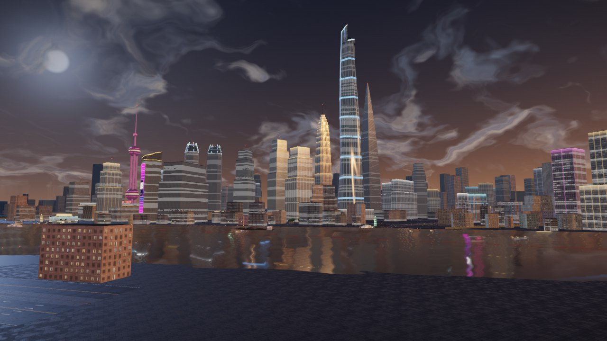
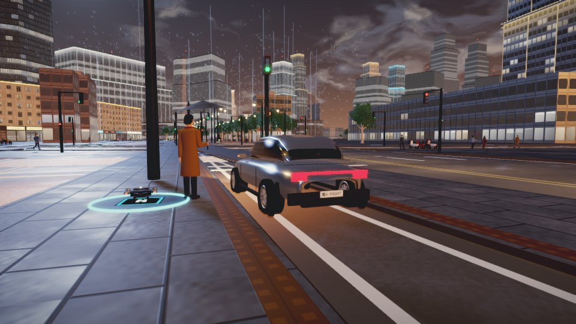
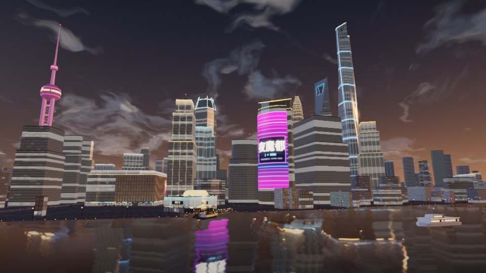
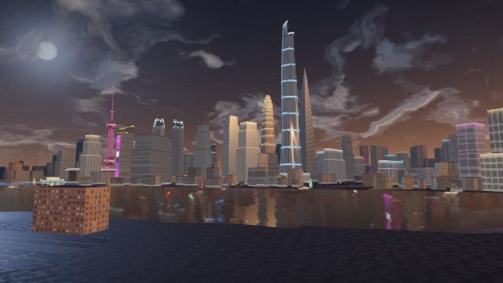

# 魔都夜行 · MODU NIGHT WALK

**一个单文件 WebGL 城市技术演示：把 OpenStreetMap 的滨江几何重建为雨夜城市，并在浏览器里跑一套轻量的夜间出行模拟。**

<p align="center">
  
</p>

> **技术演示 · 不发行（TECHNICAL DEMO · NOT FOR RELEASE）**
>
> 本仓库只公开源码，供技术研究与学习使用。它不是游戏发行：不运营、不提供安装包/下载站分发、不收费、不接广告、不联机、不提供排行榜或任何在线服务；不收集个人信息。公开源码不等于授权发行或运营。原创代码与文案仅限非商业使用（[LICENSE](LICENSE)）；地图数据按 ODbL 提供（[DATA-LICENSE.md](DATA-LICENSE.md)）。详见 [DISCLAIMER.md](DISCLAIMER.md)。


`Three.js r169` · `WebGL` · `OpenStreetMap` · `Vanilla JS` · `Single-file build` · `GitHub Actions Pages`

---

## Overview

《魔都夜行》是一个**技术演示（interactive technical demo）**，不是准备发行或运营的游戏产品。它用于验证几件工程上互相牵制的事：

- 大规模 OSM 几何在浏览器里的裁剪、投影、简化与实时重建；
- 程序化城市内容（建筑立面、招牌、纹理、街道家具、天气、灯光）的生成管线；
- 城市尺度下的步行 / 驾驶 / 载具 / 无人机 / 室内交互；
- 单文件、零运行时网络请求的离线交付；
- 桌面与移动端的输入、画质与性能取舍。

项目以「雨夜、23:00–01:00、想办法回家」为叙事框架，把技术验证放进一个可玩的短流程里：7 个委托、5 张明信片、4 种回家结局、40 个城市手账章。

---

## Screenshots

> 以下画面均来自演示构建；城市、建筑、店铺、人物名称均为虚构或改写。截图不含真实个人信息。

| <br><sub>滨江天际线 · 当前构建</sub> | <br><sub>街道层 · 步行 / 载具 / 无人机</sub> |
|---|---|
| <br><sub>黄昏光照与江面反射</sub> | <br><sub>夜景 · 雾、月光与楼宇灯光</sub> |


<sub>星珠塔的六种灯光程序：经典粉、冰蓝、香槟金、彩虹环、上升波、星光。颜色、格栅、光环、塔身泛光与广场点光同步渐变。</sub>

---

## What the demo covers

- **1:1 OSM 几何**：约 2.5 × 2.2 km 的滨江区域，建筑轮廓、道路、步行道、岸线、绿地、POI。
- **可进入的室内**：环港广场中庭及六间店、魔都中心大堂 / L2 / L3、江畔咖啡、夜航小馆、渡口候船厅、邮船沙龙。
- **可走的高处**：星珠环、滨江上层步道、空中连廊。
- **交通**：步行、纯电自驾、出租车（路网寻路）、渡轮、夜宵 N1、游船。
- **系统**：委托、手机 App、拍照评分、无人机、天气与体温、钱包/罚款、结局评级。
- **表现**：雨、湿路面、雾、月光、楼宇灯光秀、程序化招牌与纹理、WebAudio 合成环境声。

---

## Technical overview

### 1. 数据管线

OSM 数据在进入运行时前做了裁剪、投影、简化与人工修补，并以紧凑数组内联到 `src/js/05-osm.js` 与 `src/js/06-shenxi.js`：

| 数据 | 条目 |
|---|---:|
| 建筑 / 地物轮廓 | 413 |
| 道路段 | 612 |
| 步行道 / 广场 | 503 |
| 绿地 / 公园 | 114 |
| POI | 24 |

- 坐标：经纬度投影为本地米制坐标（+x 东、+z 南），**不公开真实投影原点**。
- 名称：地名、建筑名、店铺名、品牌名系统性改写为虚构名称；几何与体量保留。
- 许可：OSM 衍生数据库按 **ODbL 1.0** 提供，署名与相同方式共享要求见 [DATA-LICENSE.md](DATA-LICENSE.md)。

### 2. 渲染

- **Three.js r169 / WebGL**，单 canvas，`PCFSoftShadowMap`，线性色彩空间。
- **自定义天空 shader** + 阈值/模糊/合成三段式 bloom，控制夜景高光与灯光溢出。
- **湿路面**：通过 `onBeforeCompile` 注入片元着色器，混合反射、粗糙度与雨痕。
- **程序化内容**：立面、招牌、路面、纹理由 Canvas 生成；`CanvasTexture` 与 `InstancedMesh` 复用重复元素。
- **确定性帧**：固定随机种子与 `?shot=1&freeze=1`，便于截图、回归和 diff。

### 3. 模拟

- 固定 23:00–01:00 的时间盒，现实 1 秒 = 游戏 3 秒；暴雨与灯光秀按时间表触发。
- 行人、车辆、出租车、渡轮、夜宵线、游船各自有轻量状态机；出租车按路网寻路。
- 委托、手机、拍照评分、无人机电量/信号、钱包与交通罚款构成一条闭环。
- 四个结局（渡轮 / N1 / 出租车 / 滞留）都结算评级，没有“失败”。

### 4. UI 与交互

- DOM/CSS HUD：手机、地图、手册、暂停、设置、结算。
- 桌面：WASD + 鼠标 + 快捷键；移动端：虚拟摇杆、拖动环视、触屏互动按钮。
- 画质三档，触屏默认降一档；设置、最高分、结局与地图标记保存在本机 `localStorage`。

### 5. 构建与打包

- `build.mjs` 不依赖打包器：读取 Three.js、CSS 与游戏源码，内联为一个 HTML。
- 运行时**零网络请求**；Three.js、纹理、OSM 数据、音频全部内联。
- 构建产物约 **2.6 MB**；仓库只提交源码，`modu-nightrun.html` / `dist/` 由本地或 CI 生成。

---

## Quick start

```bash
# 1. 构建单文件演示
node build.mjs

# 2. 用 Chrome / Edge / Safari 打开
open modu-nightrun.html
```

无需 `npm install`。需要支持 WebGL 的现代浏览器。

### GitHub Pages 技术预览

部署后的地址形如：

```text
https://<你的 GitHub 用户名>.github.io/<仓库名>/
```

这是**在线技术预览**，不是游戏发行：没有安装包、下载站、账号、支付、广告、联机或排行榜。构建由 [`.github/workflows/pages.yml`](.github/workflows/pages.yml) 在 CI 中完成，构建产物不提交到仓库。

启用步骤：

1. 把仓库推到 GitHub 的 `main` 分支；
2. **Settings → Pages → Build and deployment → Source** 选 **GitHub Actions**；
3. Actions 里的 **“Deploy technical demo to GitHub Pages”** 会自动构建部署，也可手动 `Run workflow`；
4. 在 deploy 步骤或 Pages 设置里取得 URL。

如果默认分支不是 `main`，把 workflow 里的 `branches: [main]` 改成你的分支名。

---

## Controls

| 输入 | 动作 |
|---|---|
| `WASD` / 方向键 | 步行、驾驶、无人机 |
| `Shift` | 奔跑 / 无人机下降 |
| `Space` | 手刹 / 无人机上升 |
| 鼠标 | 环视；点击画面锁定鼠标；`Esc` 释放 |
| `Q` | 举起 / 收起相机（滚轮变焦） |
| `E` | 互动：拍摄、进门、购买、取送、检票 |
| `F` | 上车 / 下车 |
| `T` | 扬招出租车；`1`–`5` 选目的地，`0` 回酒店 |
| `V` | 放飞 / 召回无人机；`C` 视角、`E` 航拍、`R` 返航 |
| `Tab` | 手机；`Backspace` 返回；`Esc` 收起 |
| `M` | 大地图 |
| `J` / `H` | 手账 / 手册 |
| `O` | 第一 / 第三人称 |
| `N` / `P` / `Esc` | 静音 / 暂停 / 返回 |

触屏：左下摇杆移动，拖动屏幕环视，右侧互动按钮；点「手机」打开手机，点小地图打开大地图。

---

## Project layout

```text
build.mjs                     inline Three.js + CSS + game → single HTML
src/index.template.html       HUD, phone, title, pause, settings, results
src/style.css                 all UI styles
src/js/00-core.js             renderer, sky, bloom, wet road, weather
src/js/01-facade.js           procedural building facades
src/js/02-people.js           procedural people
src/js/05-osm.js              OSM-derived map data (ODbL)
src/js/06-shenxi.js           opposite-bank building outlines (ODbL)
src/js/10-city.js             OSM parse, roads, buildings, street furniture
src/js/12-landmarks.js        four towers and landmark geometry
src/js/13* … 18-*.js          neighborhoods, interiors, cruise, mall, bridges
src/js/19-tunnels.js          tunnel portals and ramps
src/js/20-actors.js           people, vehicles, taxi, drone, traffic
src/js/30-game-1-core.js      state, clock, endings, scoring
src/js/30-game-2-motion.js    movement, driving, camera, drone
src/js/30-game-3-interiors.js interior transitions, interactions
src/js/30-game-4*.js          camera/HUD, map, manual, jobs, phone
src/js/30-game-5-loop.js      main loop, input, selftest, debug params
docs/screenshots/             README screenshots
.github/workflows/pages.yml   GitHub Pages build/deploy
LICENSE                       PolyForm Noncommercial 1.0.0
DATA-LICENSE.md               ODbL notice and attribution
LICENSES/ODbL-1.0.txt         full ODbL text
THIRD-PARTY-NOTICES.md        Three.js MIT and other notices
DISCLAIMER.md                 technical scope, fiction, compliance, privacy
```

---

## Verification

开发期使用一套**不随仓库分发**的内部 harness（8 个 gate：shaders / census / collide / lights / playtest / product / mobile / look）。历史上的 8/8 通过记录是在本轮文案与许可修改之前；修改后尚未重新跑完整 harness。

可复现的部分：

- `node build.mjs`：构建成功，产物约 2.6 MB；
- `node --check`：除按文件名拼接的 `30-game-1-core.js` / `30-game-5-loop.js` 外，其余模块语法检查通过；
- `__TEST('selftest')`：在浏览器控制台运行，覆盖拍五张明信片 → 发给老周 → 渡轮 / N1 / 打车 / 01:00 滞留 → 重新开始；
- 运行时网络检查：`build.mjs` 会扫描 `fetch`、`XMLHttpRequest`、外部图片/字体引用。

> 截图与性能数字来自开发机；不同 GPU、浏览器和画质档位会有差异。

---

## Limitations

- 过江隧道洞口未建模，隧道段仍按地面道路绘制，车辆不能真正过江。
- 星珠塔所在的滨江段仍偏空；部分路面与街道家具是程序化简化。
- 地名与建筑名已改写，但 1:1 几何与建筑体量仍可能被识别；本项目**不是地图服务**，不用于导航、测绘或安全关键用途。
- 截图可能来自不同构建；README 的 UI 文案以当前源码为准。
- 本项目是技术演示，不承诺 API 稳定、存档兼容或长期维护。

---

## Licensing

本仓库采用**分许可**：

| 内容 | 许可 |
|---|---|
| 原创代码、文案、程序化生成资产 | **PolyForm Noncommercial 1.0.0**（仅限非商业） |
| OpenStreetMap 衍生地图数据 | **ODbL 1.0**（署名 + 相同方式共享） |
| Three.js r169 | **MIT** |

- 代码/文案：见 [LICENSE](LICENSE)；
- 地图数据：见 [DATA-LICENSE.md](DATA-LICENSE.md) 与 [LICENSES/ODbL-1.0.txt](LICENSES/ODbL-1.0.txt)；
- 第三方：见 [THIRD-PARTY-NOTICES.md](THIRD-PARTY-NOTICES.md)。

**注意**：非商用条款**不适用于** OSM 数据。ODbL 不允许对衍生数据库附加额外限制，且 ODbL 本身允许商业使用。若只使用代码，遵守 PolyForm 非商业许可；若复制地图数据，遵守 ODbL。

由于含非商业条款，本项目属于**源码公开（source-available）**，不是 OSI 定义的开源项目。若希望真正开源，可将代码改为 MIT / Apache-2.0，数据仍保持 ODbL。

---

## Privacy & compliance

- 无账号、无遥测、无分析脚本、无外部请求；不收集任何个人信息。
- 仅使用浏览器 `localStorage` 保存设置、最高分、已见结局和地图标记；清空浏览器数据即可删除。
- 联系人与对话均为虚构角色，不包含真实姓名、电话、邮箱或住址。
- 发布前请检查 Git 提交身份：`git config user.name` / `user.email` 会写入公开提交历史；建议使用 GitHub noreply 邮箱或项目专用邮箱。
- 本作不是地图服务，不用于导航、测绘或安全关键用途；OSM 数据可能有误。
- 中国境内公开发布或运营含地图/游戏内容，可能涉及地图审核、游戏审批/备案与未成年人保护要求；本项目未申请任何审核，相关义务由发布/运营方自行承担。
- 本项目不构成法律意见。

---

## Credits

- Map data: **© OpenStreetMap contributors**, ODbL 1.0.
- Renderer: **Three.js r169**, MIT.
- Geometry, textures, signage, audio and UI: generated by this repository's code.
- Screenshots: captured from the demo; no third-party image assets are included.
