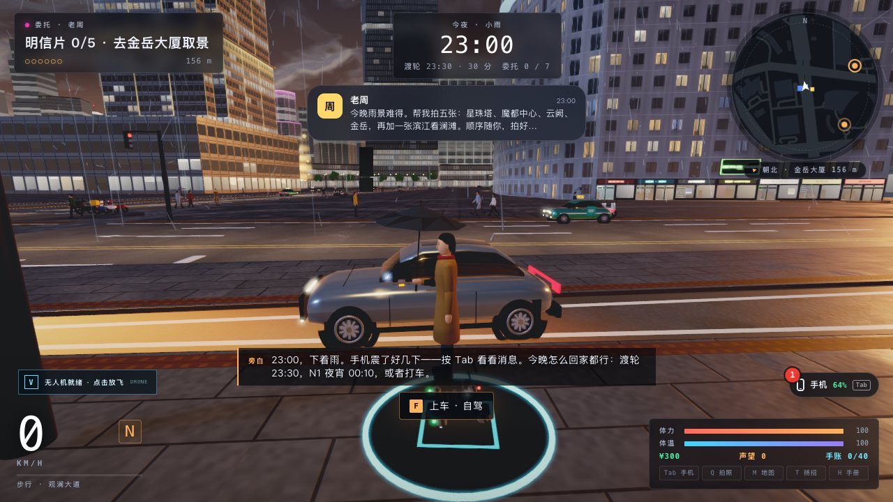
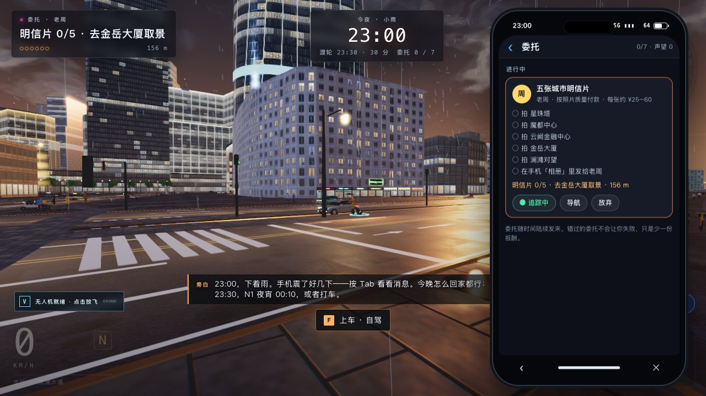
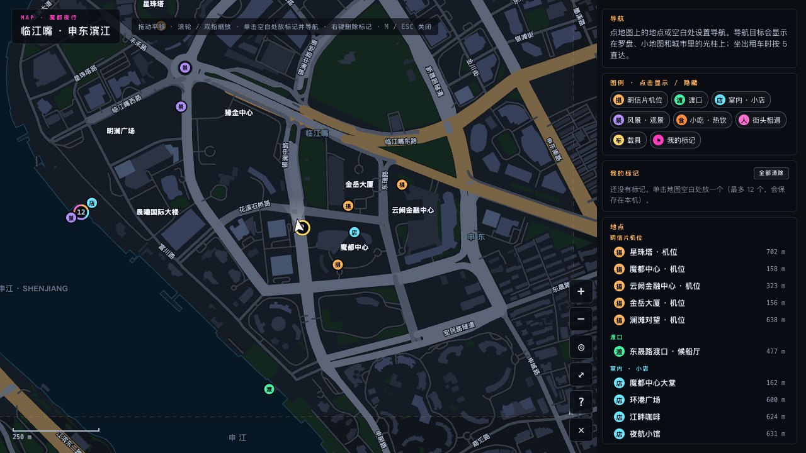
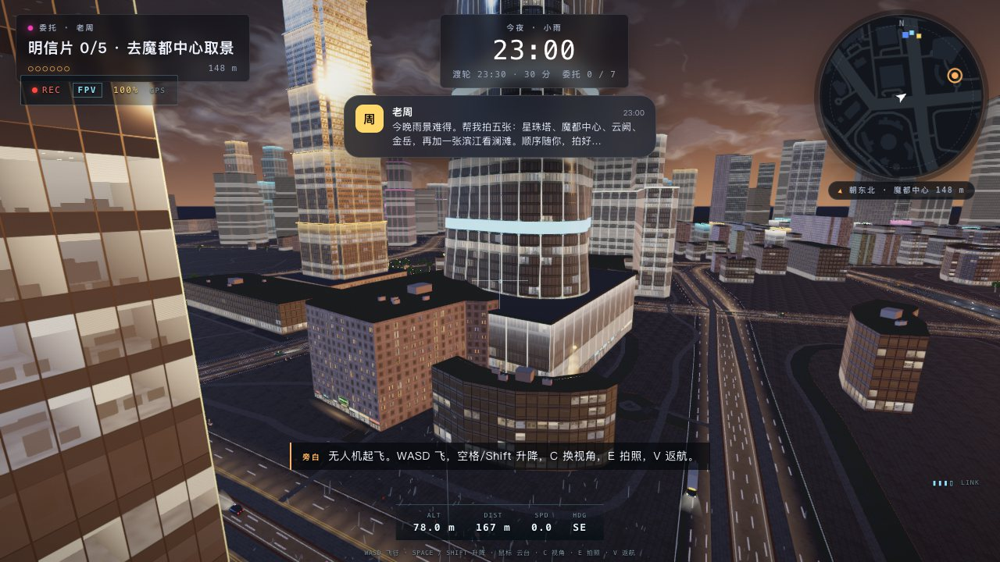
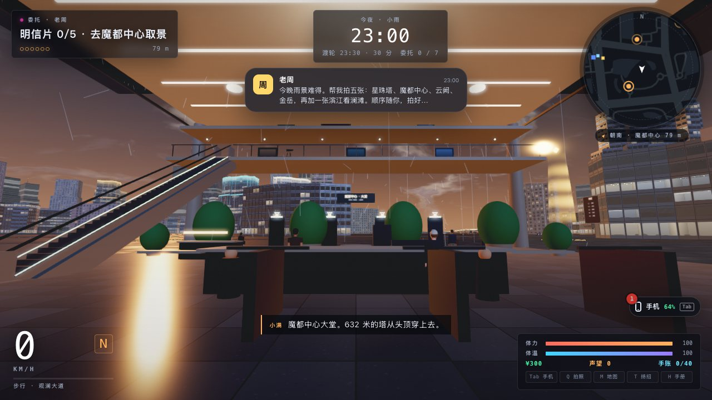
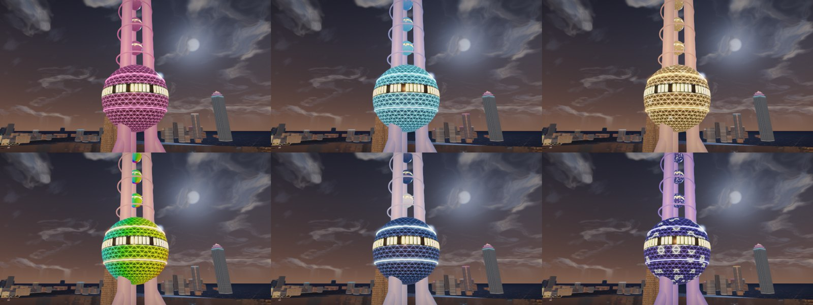

# 魔都夜行 · MODU NIGHT WALK

**A single-file WebGL demo that reconstructs a rainy waterfront district from OpenStreetMap geometry and runs a compact night-errand simulation in the browser.**

<p align="center">
  
</p>


`Three.js r169` · `WebGL` · `OpenStreetMap` · `Vanilla JavaScript` · `Single-file build` · `GitHub Pages`

---

## Status

| | |
|---|---|
| Project type | Technical demo / interactive visualization |
| Distribution | Source-available; **not released or operated** |
| License | Code: PolyForm Noncommercial 1.0.0 · Data: ODbL 1.0 |
| Preview | GitHub Pages build only; no installers, accounts, payments, ads, or online services |

---

## Overview

MODU NIGHT WALK reconstructs a 2.5 × 2.2 km waterfront district from OpenStreetMap geometry and renders it as a rainy night city in a single HTML file. A compact simulation layer—walking, driving, taxi, ferry, night bus, photography, drone—is built on top to exercise the data and rendering pipeline under realistic constraints.

The implementation uses Three.js r169 and vanilla JavaScript without a bundler. Building geometry, facades, signage, textures, and audio are generated from code; the resulting page makes no network requests at runtime. The repository contains source and build tooling only, while the single-file build is produced locally or in CI.

The narrative frame is a short night-errand loop: help a handful of residents, photograph the city, and find a way home before 01:00. The primary subject, however, is the technology: OSM data reduction, procedural city construction, deterministic rendering, and single-file delivery.

---

## Screenshots

| | |
|---|---|
| <br><sub>Phone · commission list, objectives and rewards</sub> | <br><sub>Map · districts, POIs, routes and user pins</sub> |
| <br><sub>Drone · FPV camera, altitude and signal HUD</sub> | <br><sub>Interior · tower lobby and escalators</sub> |



<sub>Six lighting programmes for the landmark tower: classic pink, ice blue, champagne, rainbow ring, rising wave, starlight. Colours, lattice, rings, facade glow and plaza lights interpolate together.</sub>

---

## Capabilities

| Area | Implementation |
|---|---|
| City | 413 building entries, 612 road segments, 503 footpaths, 114 green areas, 24 POIs from OSM |
| Interiors | Mall atrium and six shops, tower lobby / L2 / L3, riverside café, bar, ferry hall, cruise saloon |
| Transport | Walking, electric car, taxi with road-network pathfinding, ferry, night bus, river cruise |
| Systems | Commissions, phone apps, photo scoring, drone flight, weather and body temperature, wallet and fines, four endings |
| Rendering | Custom sky and bloom shaders, wet-road shader injection, procedural facades, instanced street furniture, PCF soft shadows |
| Delivery | One HTML file, zero runtime requests, deterministic seed, keyboard/mouse/touch input |

---

## Technical design

### Data pipeline

OSM data is cropped, projected into local metres, simplified, and manually patched before being stored as compact arrays in `src/js/05-osm.js` and `src/js/06-shenxi.js`.

| Dataset | Entries |
|---|---:|
| Building / feature outlines | 413 |
| Road segments | 612 |
| Footpaths / plazas | 503 |
| Green areas / parks | 114 |
| POIs | 24 |

Coordinates are projected to a local metric frame (+x east, +z south); the real projection origin is not published. Place and building names are systematically rewritten for the fictional setting. Geometry and massing are retained.

The OSM-derived database is distributed under **ODbL 1.0**; attribution and share-alike requirements are documented in [DATA-LICENSE.md](DATA-LICENSE.md).

### Rendering

- Three.js r169 on WebGL, one canvas, `PCFSoftShadowMap`, linear colour space.
- Custom sky shader and a threshold / blur / composite bloom chain.
- Wet-road shading injected through `onBeforeCompile`, combining reflection, roughness, and rain streaks.
- Procedural facades, signage, road markings, and textures generated with Canvas; repeated elements use `InstancedMesh`.
- Deterministic frames via a fixed seed and `?shot=1&freeze=1`, used for capture and regression comparison.

### Simulation

- Fixed 23:00–01:00 time window; one real second equals three game seconds.
- Scheduled rainstorm and building light show.
- Lightweight state machines for pedestrians, vehicles, taxi, ferry, night bus, and cruise.
- Commissions, phone, photo scoring, drone battery/signal, wallet, traffic fines, and four endings form one closed loop.

### Interface

- DOM/CSS HUD: phone, map, manual, pause, settings, results.
- Desktop: keyboard, mouse, and shortcuts. Mobile: virtual joystick, drag look, touch interaction.
- Three quality presets; settings, best score, endings, and map pins stored in `localStorage`.

### Build

`build.mjs` reads Three.js, CSS, and game sources, then inlines them into one HTML file. No bundler or package manager is required. The output is approximately 2.6 MB and contains the complete license banner.

---

## Quick start

```bash
node build.mjs
open modu-nightrun.html
```

Node.js and a WebGL-capable browser are required. There are no npm dependencies.

### GitHub Pages preview

The workflow in [`.github/workflows/pages.yml`](.github/workflows/pages.yml) builds the same HTML in CI and deploys it as a technical preview.

1. Push to `main`.
2. Set **Settings → Pages → Build and deployment → Source** to **GitHub Actions**.
3. The workflow `Deploy technical demo to GitHub Pages` builds and deploys automatically; it can also be started manually with `workflow_dispatch`.
4. The preview URL follows `https://<username>.github.io/<repository>/`.

If the default branch is not `main`, update `branches` in the workflow. Public repositories can use GitHub Pages at no cost; private repositories require a plan that supports Pages.

---

## Controls

| Input | Action |
|---|---|
| `WASD` / arrows | Walk, drive, or fly |
| `Shift` | Sprint / descend |
| `Space` | Handbrake / ascend |
| Mouse | Look; click to lock the pointer; `Esc` releases |
| `Q` | Raise or lower the camera (wheel to zoom) |
| `E` | Interact: photograph, enter, buy, pick up, drop off, board |
| `F` | Enter or exit a vehicle |
| `T` | Hail a taxi; `1`–`5` choose a destination, `0` returns to the hotel |
| `V` | Launch or recall the drone; `C` camera, `E` photo, `R` return |
| `Tab` | Phone; `Backspace` back; `Esc` close |
| `M` | Full-screen map |
| `J` / `H` | Journal / handbook |
| `O` | First- or third-person camera |
| `N` / `P` / `Esc` | Mute / pause / back |

Touch: joystick at lower left, drag elsewhere to look, interaction buttons at lower right; tap the phone or minimap to open the corresponding overlay.

---

## Repository layout

```text
build.mjs                     inline Three.js + CSS + game → single HTML
src/index.template.html       HUD, phone, title, pause, settings, results
src/style.css                 all UI styles
src/js/00-core.js             renderer, sky, bloom, wet road, weather
src/js/01-facade.js           procedural building facades
src/js/02-people.js           procedural people
src/js/05-osm.js              OSM-derived map data (ODbL)
src/js/06-shenxi.js           opposite-bank building outlines (ODbL)
src/js/10-city.js             OSM parse, roads, buildings, street furniture
src/js/12-landmarks.js        four towers and landmark geometry
src/js/13* … 18-*.js          neighbourhoods, interiors, cruise, mall, bridges
src/js/19-tunnels.js          tunnel portals and ramps
src/js/20-actors.js           people, vehicles, taxi, drone, traffic
src/js/30-game-1-core.js      state, clock, endings, scoring
src/js/30-game-2-motion.js    movement, driving, camera, drone
src/js/30-game-3-interiors.js interior transitions, interactions
src/js/30-game-4*.js          camera/HUD, map, manual, jobs, phone
src/js/30-game-5-loop.js      main loop, input, selftest, debug parameters
docs/screenshots/             README screenshots
.github/workflows/pages.yml   GitHub Pages build/deploy
LICENSE                       PolyForm Noncommercial 1.0.0
DATA-LICENSE.md               ODbL notice and attribution
LICENSES/ODbL-1.0.txt         full ODbL text
THIRD-PARTY-NOTICES.md        Three.js MIT and other notices
DISCLAIMER.md                 technical scope, fiction, compliance, privacy
```

---

## Verification

Development used an internal harness, not distributed with this repository, with eight gates: shaders, census, collide, lights, playtest, product, mobile, and look. The last recorded full pass is from an earlier build; the harness has not been re-run against the current documentation and licensing revision.

Reproducible checks:

- `node build.mjs` produces a single HTML file of approximately 2.6 MB.
- `node --check` passes for all modules except `30-game-1-core.js` and `30-game-5-loop.js`, which are intentionally split across files and closed by the build order.
- `__TEST('selftest')` in the browser console covers five postcards → send to the postcard shop → ferry / night bus / taxi / 01:00 stranded → restart.
- `build.mjs` scans the source for `fetch`, `XMLHttpRequest`, and external asset references.

Screenshots and performance figures come from a development machine; GPU, browser, and quality preset affect the result.

---

## Limitations

- Tunnel portals are not fully modelled; the tunnel segments are still drawn as surface roads, and vehicles cannot cross the river underground.
- The waterfront around the landmark tower remains sparse; some road surfaces and street furniture are procedural simplifications.
- The 1:1 geometry and building massing remain recognisable despite rewritten names. The demo is not a map service and must not be used for navigation, surveying, or safety-critical purposes.
- The internal verification harness is not part of the repository.
- The project is a technical demo and makes no compatibility or maintenance guarantees.

---

## License

| Content | License |
|---|---|
| Original code, text, and procedurally generated assets | **PolyForm Noncommercial 1.0.0** (non-commercial only) |
| OpenStreetMap-derived map data | **ODbL 1.0** (attribution + share-alike) |
| Three.js r169 | **MIT** |

The non-commercial clause does **not** apply to the OSM data. ODbL does not permit additional restrictions on a derivative database, and ODbL itself allows commercial use. Code and data therefore use separate licenses:

- Code and text: [LICENSE](LICENSE)
- Map data: [DATA-LICENSE.md](DATA-LICENSE.md) and [LICENSES/ODbL-1.0.txt](LICENSES/ODbL-1.0.txt)
- Third-party components: [THIRD-PARTY-NOTICES.md](THIRD-PARTY-NOTICES.md)

Because of the non-commercial clause, the project is **source-available**, not OSI open source.

---

## Privacy and compliance

The demo collects no personal data. It has no accounts, analytics, telemetry, or runtime network requests. Browser `localStorage` stores settings, best score, endings, and map pins only.

The work is a fictional technical demo. Characters, shops, institutions, and events are invented or rewritten; the map geometry is derived from OpenStreetMap and is provided under ODbL.

The demo is not a map service and is not intended for navigation, surveying, or safety-critical use. Publishing maps or games in mainland China may involve map review, game approval or filing, and minor-protection requirements; this project has not applied for any such approval. Nothing in this repository is legal advice. See [DISCLAIMER.md](DISCLAIMER.md).

---

## Credits

- Map data: **© OpenStreetMap contributors**, ODbL 1.0.
- Renderer: **Three.js r169**, MIT.
- Geometry, textures, signage, audio, and UI: generated by this repository's code.
- Screenshots: captured from the demo; no third-party image assets are included.
